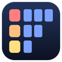
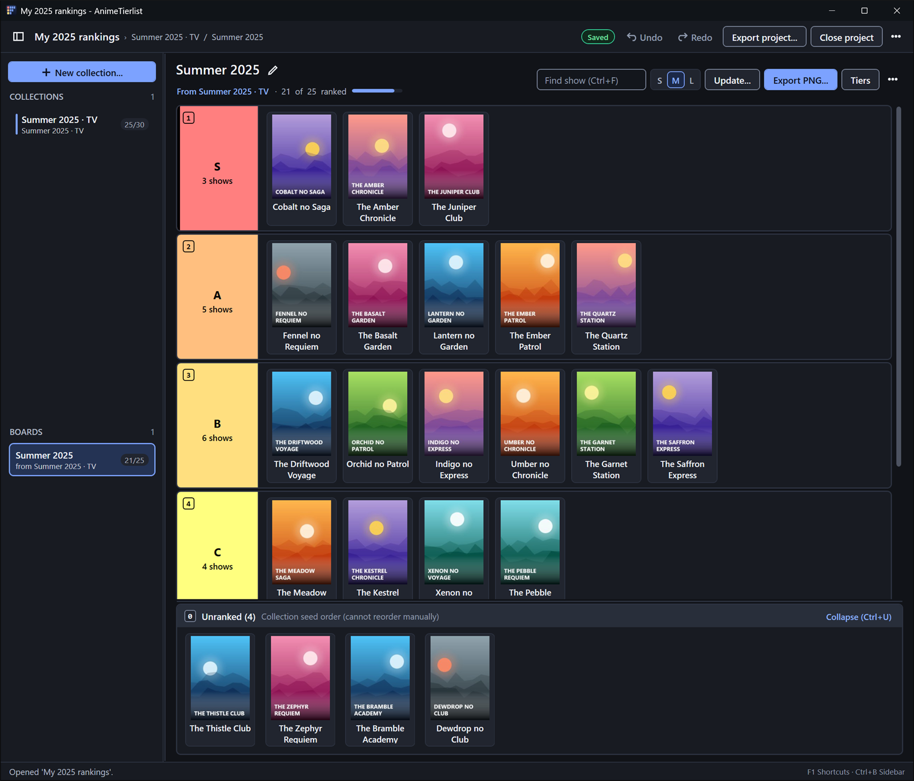
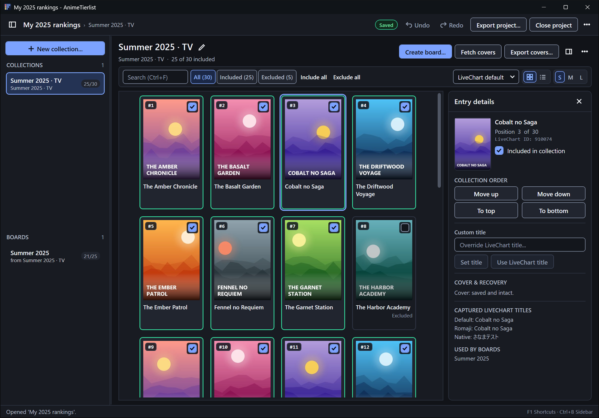
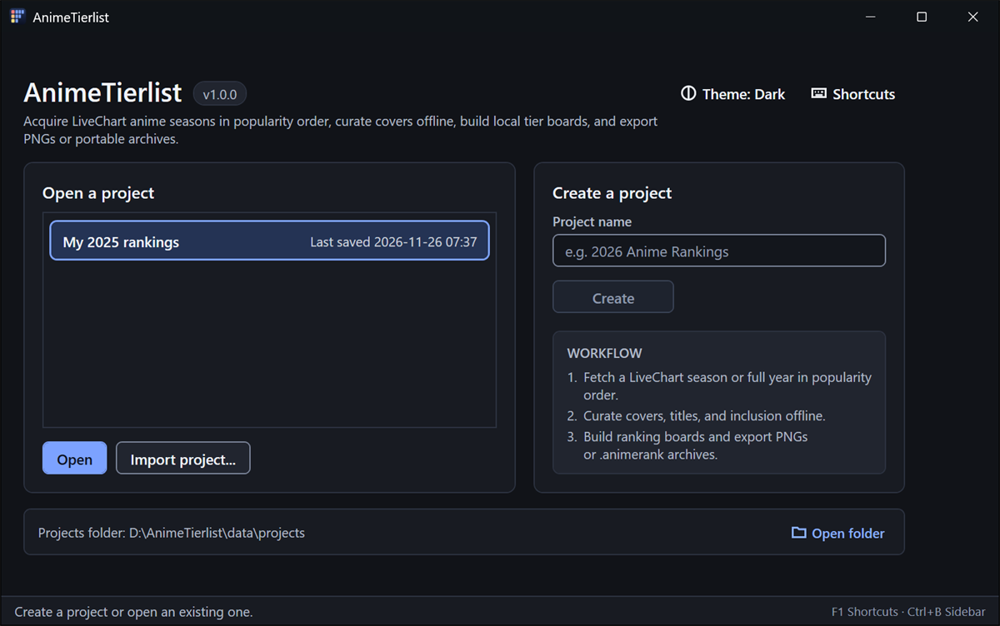
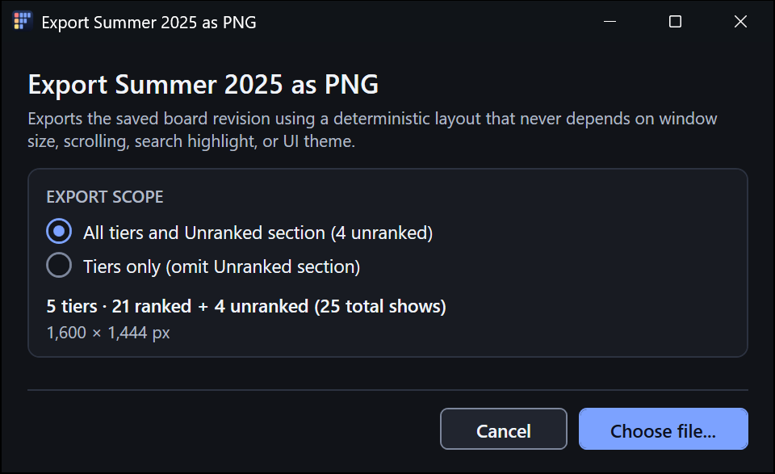

<div align="center">



# AnimeTierlist

**Rank anime seasons on tier boards, offline, on Windows.**

Fetch a season from [LiveChart](https://www.livechart.me/) in its popularity order, curate the shows you watched, rank them by drag and drop, and export the board as a PNG.

[](https://github.com/Gawron253/AnimeTierlist/releases)
[](https://github.com/Gawron253/AnimeTierlist/actions/workflows/ci.yml)
[](LICENSE)


[Download](#download) · [Features](#features) · [Usage](#usage) · [Privacy](#network-and-privacy) · [Building](https://github.com/Gawron253/AnimeTierlist/blob/main/docs/BUILDING.md)



</div>

> [!NOTE]
> The screenshots use invented shows and generated cover art. In the app, shows and covers come from LiveChart.

## Features

- **Season and year fetches.** Pick a season (winter, spring, summer, fall) or a whole year, and filter by TV, Movies, OVAs, or All. Shows keep LiveChart's popularity order. A whole year combines the seasons in calendar order, winter first, and keeps a repeated show at its first appearance.
- **Cover downloads.** Covers download in the background at the largest size LiveChart publishes. A missing cover stays a placeholder you can retry, and retrying never changes show order.
- **Collections and title languages.** Include or exclude shows, search, reorder by hand, and switch between LiveChart's default title, English, romaji, native, or a custom title per show.
- **Tier boards.** Create several boards from one collection. Rename, recolor, reorder, add, or delete tiers. Rank by drag and drop or with the keyboard, and place duplicate copies of a show when you need them.
- **Show details and OP/ED player.** Double-click a show on a board to see its LiveChart details, AniList and MyAnimeList links, and its videos, openings and endings first. YouTube videos play in the app or open in your browser. Details and the player open inside the main window, so sharing that window (for example in Discord) shows them too.
- **Reviewed updates.** **Check LiveChart for updates** previews added, removed, renamed, and reordered shows before applying anything. **Update...** on a board syncs it with its collection and keeps the placements of shows that stay on the board.
- **Autosave and undo.** Every change saves automatically. `Ctrl+Z` and `Ctrl+Y` undo and redo until you close the project. The UI has dark, light, and system high-contrast themes.
- **Exports.** Save a board as a 1,600-pixel-wide PNG, with or without Unranked. Copy a collection's included covers into a new folder as numbered files with a JSON manifest, or export and import whole projects as `.animerank` archives.

<table>
  <tr>
    <td width="50%"></td>
    <td width="50%"></td>
  </tr>
  <tr>
    <td align="center"><sub>Curate a collection: include, exclude, reorder, and retitle shows</sub></td>
    <td align="center"><sub>Projects are local folders you create and open from the start screen</sub></td>
  </tr>
</table>

## Download

1. Download `AnimeTierlist-<version>-win-x64.zip` from [**GitHub Releases**](https://github.com/Gawron253/AnimeTierlist/releases).
2. Extract it to a writable folder, such as `Documents\AnimeTierlist`.
3. Run `AnimeTierlist.exe`.

Each release also includes a `.sha256` checksum file you can use to verify the download.

### Requirements

| | |
| --- | --- |
| **OS** | Windows 11 x64 (tested). Windows 10 x64 may work but has not been verified. |
| **Install** | None. No installer, administrator rights, or separate .NET runtime. Everything is in the extracted folder. |
| **Video playback** | The Microsoft Edge WebView2 Runtime, included with Windows 11. Without it, the player reports that the runtime is missing and offers **Watch on YouTube** instead. |
| **Network** | Needed only to fetch from LiveChart or play YouTube videos. Everything else works offline. |

## Usage

1. **Create a project.** Enter a name under **Create a project** and select **Create**, or pick an existing project under **Open a project**.
2. **Fetch a season.** Select **New collection...**, choose a season or a whole year and a category, then select **Fetch from LiveChart**. Review the list and select **Create collection**. Covers download in the background. **Stop covers** pauses them and **Fetch covers** resumes.
3. **Curate shows.** Every show starts included. Untick shows to exclude them, or use **Include all**, **Exclude all**, or search with **Include shown**. Search filters the view without changing the collection. **Move up**, **Move down**, **To top**, and **To bottom** adjust order, and the title-language list (**LiveChart default** at first) switches titles.
4. **Create a board.** Select **Create board...**, enter a name, and select **Create board**. Included shows start in Unranked in collection order.
5. **Rank shows.** Drag shows into tiers, or select a card and use the keyboard (below). Double-click a card for details and OP/ED videos.
6. **Export.** Use **Export PNG...** on a board, **Export covers...** on a collection, or **Export project...** in the top bar for an `.animerank` file.

<p align="center">
  
</p>

### Keyboard shortcuts

With a card selected on a board:

| Key | Action |
| --- | --- |
| <kbd>1</kbd> to <kbd>9</kbd> | Move to that tier |
| <kbd>0</kbd> | Return to Unranked |
| <kbd>Ctrl</kbd>+<kbd>←</kbd> / <kbd>Ctrl</kbd>+<kbd>→</kbd> | Reorder within the tier |
| <kbd>Alt</kbd>+<kbd>↑</kbd> / <kbd>Alt</kbd>+<kbd>↓</kbd> | Move to the row above or below (Unranked is the bottom row) |
| <kbd>Ctrl</kbd>+<kbd>Z</kbd> / <kbd>Ctrl</kbd>+<kbd>Y</kbd> | Undo or redo |

Press <kbd>F1</kbd> in the app for the full list.

> [!TIP]
> If a save fails, the toolbar offers **Retry save** and **Discard unsaved changes**. If an uploader blocks embedded playback, the player offers **Watch on YouTube** to open the video in your browser.

## Where data is stored

Projects live in `data\projects` next to `AnimeTierlist.exe`. To move the app, move the whole folder. If the app folder is read-only, AnimeTierlist asks for another data folder for the current session and does not remember the choice.

<details>
<summary>Folder layout</summary>

```text
AnimeTierlist\
├── AnimeTierlist.exe
└── data\
    ├── projects\
    │   └── <project>\
    │       ├── project.sqlite   # collections, boards, and placements
    │       ├── assets\          # original covers, named by SHA-256 hash
    │       └── cache\           # thumbnails, safe to delete
    └── webview2\                # isolated video player profile (YouTube cookies and cache), safe to delete
```

Only one running copy of the app can open a given project at a time.

</details>

## Network and privacy

AnimeTierlist has no telemetry, accounts, auto-updater, cloud sync, or background scheduler.

- For seasons, covers, and show data it contacts only `www.livechart.me` and `u.livechart.me` over HTTPS, identifies itself as `AnimeTierlist/<version>`, and sends no cookies.
- Season pages are fetched one at a time, at least five seconds apart, to respect LiveChart's crawl delay. At most two covers download at once. If LiveChart asks the app to wait, it waits or pauses instead of retrying early.
- Show details and video links are fetched only when you open a show's details, with the same pacing.
- LiveChart requests connect directly and ignore proxy settings, so networks that allow web access only through a proxy cannot fetch from LiveChart. The app tells you when this happens.
- The video player connects to YouTube only while the player is open. It uses Windows network and proxy settings, and YouTube may show its own ads or consent prompts.

> [!NOTE]
> The WebView2 Runtime sends its own diagnostic data to Microsoft according to your Windows privacy settings.

## Limitations

- Windows x64 only.
- Boards are ranked and exported locally. There is no TierMaker integration.
- Covers come from LiveChart and cannot be replaced with custom images.
- PNG exports are 1,600 pixels wide and at most 40 million pixels. For very large boards, export without Unranked or split the board.
- Undo history lasts until you close the project.

## Building from source

See [docs/BUILDING.md](https://github.com/Gawron253/AnimeTierlist/blob/main/docs/BUILDING.md) for SDK requirements, build and test commands, and release packaging.

## License

AnimeTierlist is released under the [MIT License](LICENSE).

The standalone package bundles six Microsoft runtime DLLs. By using or redistributing it, you agree to the Microsoft .NET Library License (`licenses\microsoft\MICROSOFT_DOTNET_LIBRARY_LICENSE.txt`) and the Microsoft Windows SDK License (`licenses\microsoft\WINDOWS_SDK_LICENSE.txt`) for those DLLs (listed in [THIRD_PARTY_NOTICES.md](THIRD_PARTY_NOTICES.md)), and to the remaining third-party terms in that file and the package's `licenses\` folder.
